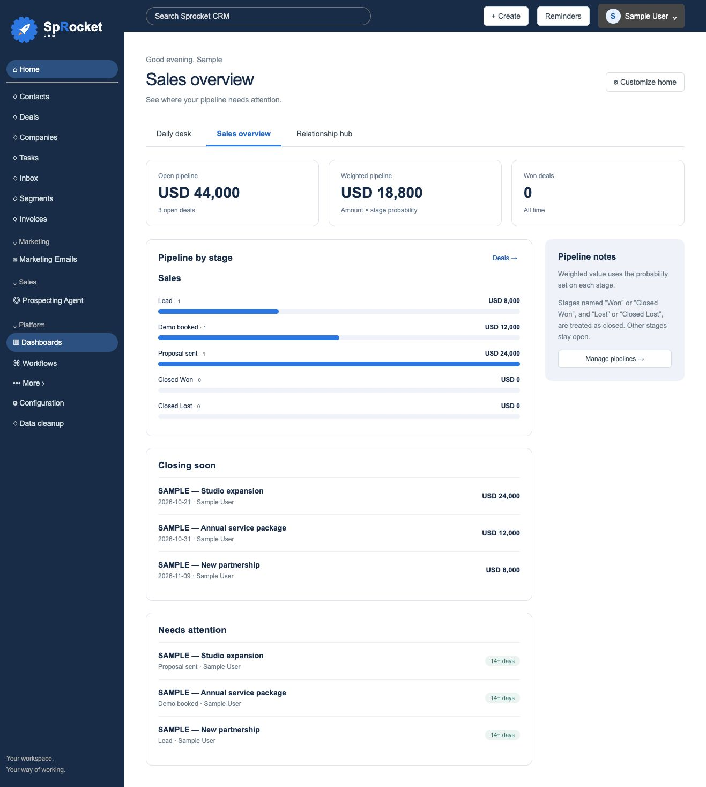
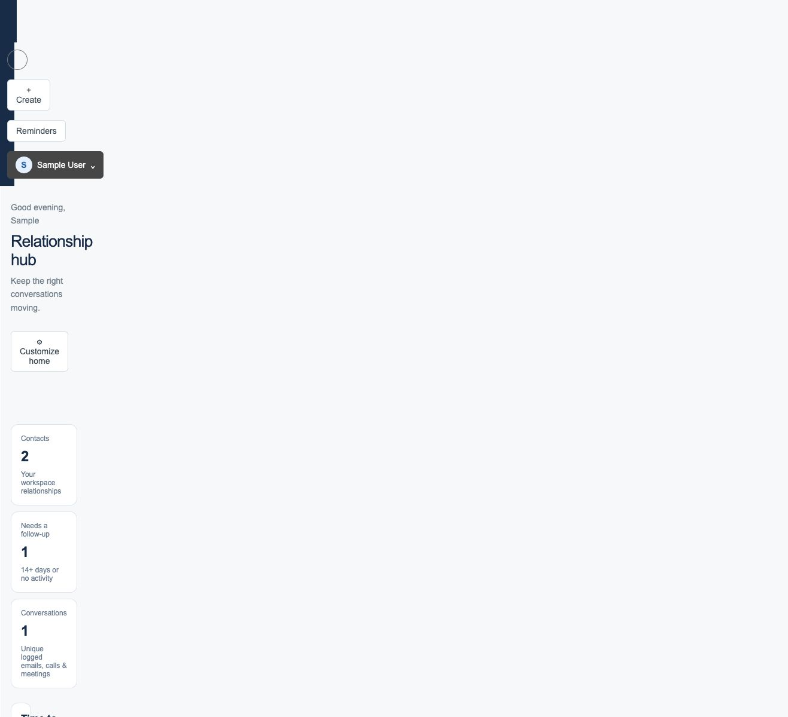
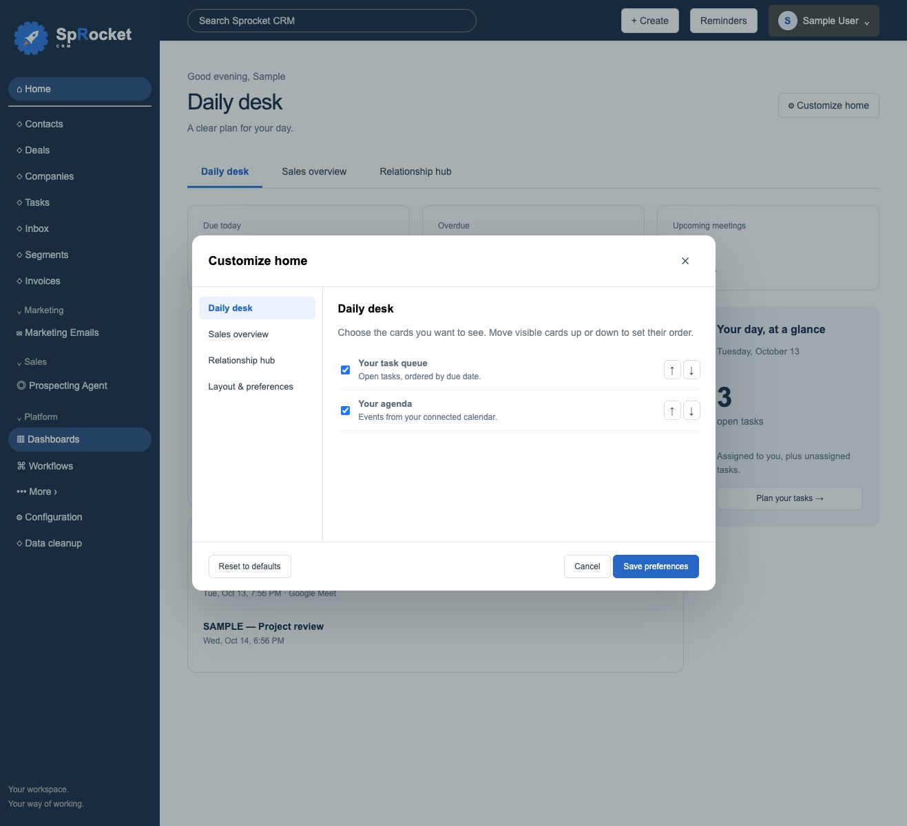

# Home dashboards and feedback

Home has three views with distinct purposes:

- **Daily desk:** your open task queue and private, synced calendar agenda. Tasks can be completed directly; repeating tasks use the existing completion workflow.
- **Sales overview:** pipeline value by stage, open and weighted pipeline totals, all-time won deal count, open deals closing in the next 30 days, and deals without recent updates.
- **Relationship hub:** contacts needing a follow-up and compact logged emails, calls and meetings. Email entries are grouped by their imported message ID, including messages logged on multiple records. Select a row to open its record.

## Customize your Home

Choose **Customize home** at the top of Home. Each view has its own card checklist and up/down ordering controls. Under **Layout & preferences**, choose your default tab, comfortable or compact spacing, side-panel visibility, task scope, agenda window (today or seven days) and inactivity threshold (7, 14 or 30 days).

**Save preferences** persists the layout for your signed-in user in the installation's database. Members can customize their own Home without administrator permissions. Cancel discards changes; Reset to defaults resets the draft and takes effect only after Save. The local app without sign-in uses one local operator profile. Calendar events come from the existing owner-scoped Calendar API; they are not added to shared workspace state.

“My tasks and unassigned” includes tasks assigned to your profile name, sign-in name/email or connected inbox address, plus unassigned tasks. CRM records remain shared within the company workspace. Contact follow-ups use the last logged activity, not the last edit to contact details. The agenda shows cached events from your selected sync window; sync Calendar to refresh it.

Sales stages named **Won / Closed Won** and **Lost / Closed Lost** are treated as terminal stages. A 0% lead or 100% open stage remains open. Weighted totals use each open deal's amount times its configured stage probability. Custom terminal-stage metadata and historical close-date reporting are future enhancements.

## Starting sales pipeline

Brand-new installations include an editable **Sales Pipeline** for Deals:

| Stage | Probability |
| --- | --- |
| Lead | 10% |
| Demo Booked | 20% |
| Demo Completed | 40% |
| Proposal Sent | 65% |
| Closed Won | 100% |
| Closed Lost | 0% |

Administrators can edit, reorder or remove its stages, add pipelines, or remove the default through **Configuration → Pipelines**. Pipelines or stages referenced by deals must be reassigned before removal. This template is created only when workspace settings are first initialized: upgrading an existing workspace never inserts or replaces pipelines, and deleting the template does not cause it to reappear.

## Feature requests and feedback

The profile dropdown includes **Feature request & feedback**. Choose Feature request, Bug report or General feedback, enter a subject and details, then select **Open email draft**. Your email app opens a draft addressed to **russ@rdfx.ca** with your feedback and the app's version, edition and build. Review and send it there. The CRM does not send automatically or include contacts, tokens, account details or diagnostic logs. **Copy email text** is available when no email handler is configured.

## Upgrade notes

This change adds an owner-scoped `dashboard_preferences` table at startup. Existing CRM data and brand assets are unchanged. Take an installation backup before upgrading as described in [UPDATES.md](UPDATES.md); older browser-restorable SQLite backups must match the current schema, so use a filesystem restore or the appropriate prior application version for an older backup.

## Sample-data previews

