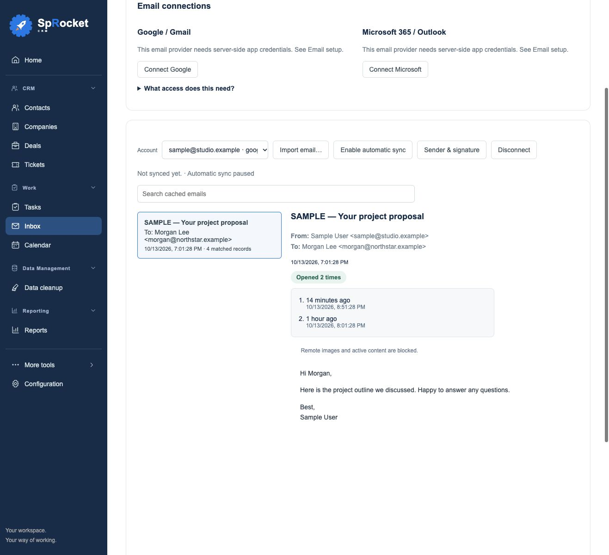

# Email open tracking

Available in web v0.2.0-beta.4. It supports messages sent from SpRocket through Gmail and Microsoft. It does not add tracking to historical messages or messages composed directly in Gmail.

## Enable and use

1. In a hosted installation, open **Configuration → Tracking & Analytics**.
2. An administrator enables **Email open tracking for this workspace**. Workspace capability and each inbox's default are initially off.
3. Set your inbox default there if desired. The composer always has a **Track opens** checkbox; change it before sending.
4. In sent-email details or linked contact/deal activity, click **Opened 1 time**, **Opened 2 times**, etc. The list expands to show every recorded timestamp and its relative age. Times are displayed in the viewer's local timezone.
5. While the CRM is visible, tracking displays check for updates roughly once a minute and preserve an expanded list. Untracked messages display **Tracking off**. A tracked message without a recorded load displays **Not opened yet**.

On a contact, **Exclude from email open tracking** prevents tracked sends to that email address; switch off the composer checkbox to send without tracking. An administrator's workspace switch stops collection for outstanding tracking links as well. Disconnecting an inbox invalidates its tracking links and preserves recorded tracking history on existing shared CRM activities.

## Hosting

Tracking uses the deployment's existing public HTTPS origin. No separate SpRocket domain or tracking vendor is required. A desktop app running on localhost cannot receive requests from recipients; new tracked sends are unavailable there. Only the transparent image endpoint is public. Settings, inboxes and event details retain normal authentication and workspace visibility.

Keep the domain stable: previously delivered image URLs cannot be changed. Links expire after 90 days. An always-available web service is preferable; Render's free-service cold start can cause image requests to time out and miss an open. Disabling collection does not delete recorded history. Timestamps remain with email/CRM data and their backups according to the installation's data-retention process.

## Counting and privacy

Counts represent requests for a small tracking image. Requests less than 30 seconds apart for the same message are collapsed to avoid counting a burst of retries as many opens. HEAD requests do not count. An image request may precede completion of the provider's send response; its signal is associated with the cached message after acceptance. Failed or uncertain sends are never automatically retried.

Counts are not proof that someone read the message. Image blocking can hide opens; privacy tools or scanners can load images automatically. Opening Gmail Sent or forwarding a message can register requests. The tooltip explains this without cluttering the main email view. Gmail can cache images, so repeated viewing may not produce repeated requests.

The CRM does not store recipient IPs, locations or browser fingerprints in tracking events. Tokens are random, contain no email address, are stored hashed and are never returned by reporting APIs. Hosting/access logs may independently record network requests. Tracking images are appended only to the delivery HTML; private previews, shared activity copies, HTML signatures and quoted content processed by the CRM omit remote tracking images. Viewing inside SpRocket does not count as an open.

## Verification

Automated tests use mock providers and disposable SQLite/PostgreSQL databases. They cover opt-in/off sends, plain text and HTML alternatives, both provider adapters, single-send reservation, early image loads, expiry, burst deduplication, unknown tokens, anonymous image access, authenticated reporting, owner-bound inbox defaults, contact exclusions, paused collection and disconnect history. Browser tests verify expansion/collapse, timestamps, relative ages, composer controls and defaults using fictional SAMPLE messages. No real mail was sent in these tests. Live recipient-client verification remains a post-deployment check with consenting test inboxes.

Further reading: [Research and design notes](EMAIL_TRACKING_PLAN.md), [general email setup](EMAIL.md).

