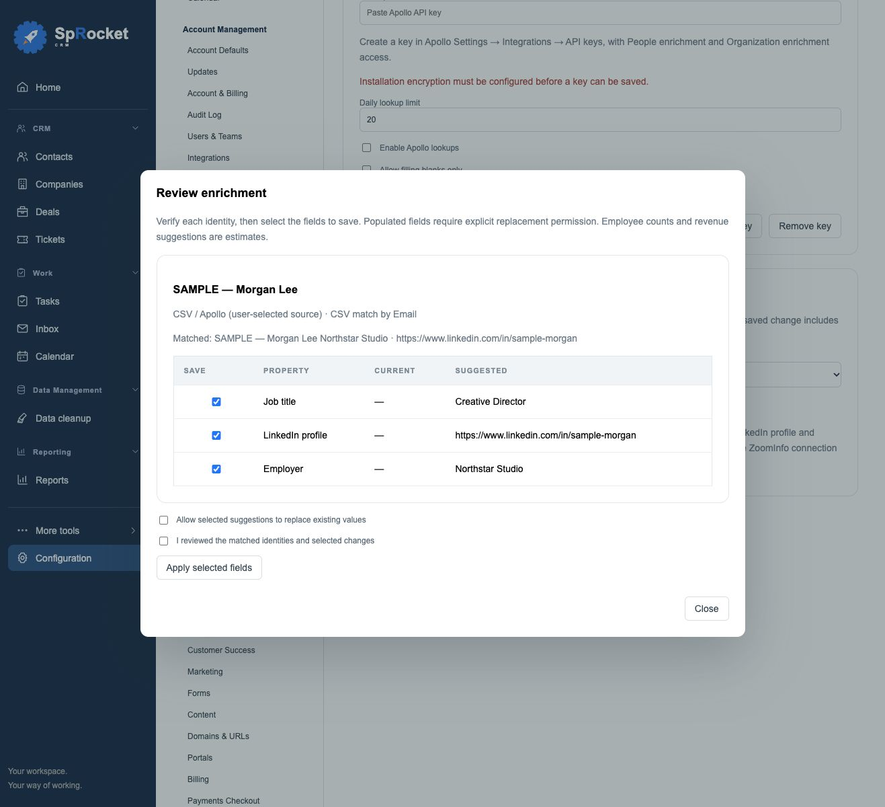

# Contact and company enrichment

Open **Configuration → Data Enrichment** to manage Apollo, field mapping and the installation's daily lookup limit. An Apollo account is optional: reviewed CSV enrichment works without one.

## Connect Apollo

1. Create an API key in Apollo Settings → Integrations → API keys. Grant People enrichment and Organization enrichment access.
2. Paste the key in Configuration → Data Enrichment. Set a daily lookup limit, enable lookups and save.
3. Use **Check saved key** to verify authentication. Endpoint access still depends on your plan and key permissions.
4. Map provider fields to CRM properties. Each CRM property can receive at most one provider field per record type. Leave fields unmapped to exclude them. Choose **Allow filling blanks only** to prevent replacements across the installation.

Keys are encrypted using the installation's existing encryption key. They are never returned to the browser, included in shared CRM state or put in provider URLs. Keep your installation encryption key with your private recovery materials. Local installations need `MAIL_TOKEN_KEY`; hosted installations use their existing stable token secret.

## Review a lookup

Open a contact or company and choose **Enrich**. For contacts, use email, a LinkedIn profile URL, or name plus employer domain. Companies need a domain or LinkedIn company page. Review the matching details and explicitly authorize sharing them with Apollo before each lookup.

The preview shows matched identity, provider confidence when supplied, current values, proposed values and estimates. Blank fields are selected by default; existing values are unselected. Confirm the identity and selected changes before applying. Replacement requires explicit permission and is unavailable when the administrator enforces filling blanks only. Nothing is saved automatically.

From a contacts or companies **list view**, select rows and choose **Enrich selected**. Apollo batches are limited to 10 records and are processed one at a time. Closing the dialog stops further requests after the current request finishes. Requests already sent may consume credits.

Lookups use a workspace-wide limit of 1–500 **attempts per UTC day**, default 20. Failed attempts count conservatively. This is not a credit balance or a spending guarantee: Apollo controls actual billing. Identical lookups reuse an unexpired preview for 15 minutes when record data and configuration are unchanged. The first release requests neither personal email reveal, mobile phone reveal nor waterfall enrichment. Company phone numbers and business phone columns in CSVs are supported.

## Enrichment CSVs

Choose **Import enrichment CSV**, select Contacts or Companies and label the export source as Apollo, ZoomInfo or Other provider. Upload or paste UTF-8 CSV, choose columns, and review matches. Maximum 100 rows and 500 KB.

Match an existing record by CRM record ID, otherwise exact contact email, exact company domain, or LinkedIn URL. Missing or ambiguous matches and duplicate rows are skipped with an explanation. This workflow never creates records. CSV source labels identify the user's selection; they do not certify where the file originated. General record creation imports remain in Data Import & Export.

Example:

```csv
email,job_title,linkedin_url
sample@example.com,Operations Manager,https://www.linkedin.com/in/sample-person
```

## Source history and undo

**Enrichment history** on each record shows who saved the changes, when, source and before/after values. The initiating user or an administrator can revert an enrichment. Undo preserves unrelated edits and refuses to replace enriched fields that were changed afterward. Changes made after preview also block application; review a fresh preview instead. Each successful batch is transactional.

LinkedIn fields are available for contacts and companies. URLs are validated and normalized. Direct LinkedIn data access and native ZoomInfo API enrichment are future work; this release supports LinkedIn matching/links and reviewed ZoomInfo CSV exports. Website fact review remains available as a separate option.

## Verification and provider references

The integration was tested with controlled Apollo responses and disposable SQLite/PostgreSQL data. A real Apollo lookup remains to be verified once an account with API access is available.

- [Apollo people enrichment](https://docs.apollo.io/reference/people-enrichment)
- [Apollo organization enrichment](https://docs.apollo.io/reference/organization-enrichment)
- [Apollo key authentication check](https://docs.apollo.io/docs/test-api-key)
- [Apollo API pricing](https://docs.apollo.io/docs/api-pricing)
- [ZoomInfo API overview](https://docs.gtm.ai/docs/overview)
- [LinkedIn Sales Navigator API access](https://learn.microsoft.com/en-us/linkedin/sales/)


