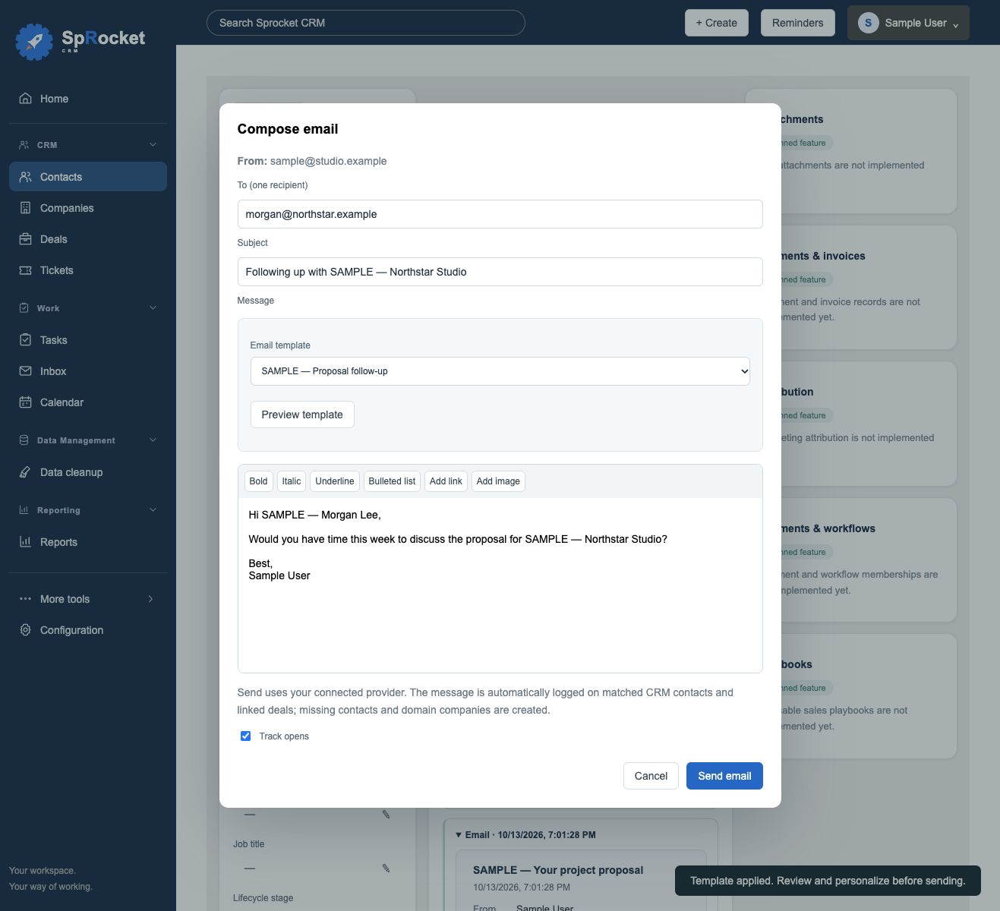
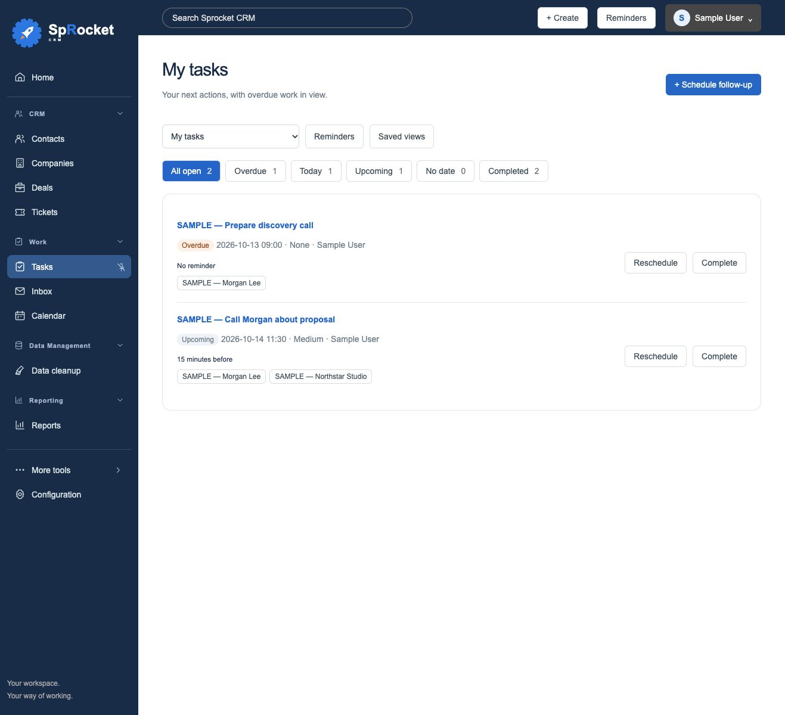

# Follow-ups and email templates

Available in web v0.2.0-beta.4.

## Your task desk

**Tasks** opens **My tasks**, showing tasks assigned to your profile name, sign-in name/email or connected email addresses. **Team tasks** shows workspace tasks; **Unassigned** keeps work without an owner separate.

Use **All open**, **Overdue**, **Today**, **Upcoming**, **No date** or **Completed** to focus the list. Today includes overdue tasks due today; these can also appear under Overdue. Due dates/times use the viewer's local timezone, consistent with existing reminders. The Overdue label accounts for the due time, defaulting to 9 AM when missing.

Use **Complete** for completion and existing repeat behavior. **Reschedule** changes due date/time and resets old reminder dismissal/snooze state. Concurrent record edits block completion or rescheduling instead of being overwritten. **Saved views** opens the existing configurable list; **My task desk** returns to the focused view.

## Schedule the next action

From a contact, company or deal, choose **Schedule follow-up**. From an email, choose **Create follow-up task**. You can also create an independent follow-up in Tasks.

Choose title, type (To-do/Call/Email), owner, date, time, priority, reminder and notes. Today/Tomorrow/Next week buttons select a date. The signed-in user's profile is the default owner. Contact/deal actions link the source and its existing contact/company/deal associations; email actions link matching contacts and their deals. Email content remains in the existing email activity rather than being copied into task notes. Scheduling logs a short task activity on linked records.

Repeated submission of the same request reuses its task. Reopening the dialog starts a new request, allowing multiple deliberate next actions for a conversation. Tasks are shared with the workspace; reminder snooze/dismiss state remains personal. The existing reminder panel supports 15-minute snooze, dismissal and optional desktop notifications while the CRM is open. Reminders are not a background email or push notification service.

## Reusable email templates

Open **More tools → Work → Message Templates**. This tool can be pinned to the sidebar.

- Personal templates are visible only to their owner.
- Administrators can create and manage workspace templates; members can use them.
- Add a name, subject and formatted message. Keep signatures out: the connected inbox's signature is added during sending.
- Available placeholders: `{{contact.first_name}}`, `{{contact.last_name}}`, `{{contact.name}}`, `{{contact.email}}`, `{{contact.job_title}}`, `{{company.name}}`, `{{company.domain}}`, `{{user.name}}`, `{{workspace.name}}`.

In the email composer, choose a template and **Preview template**. The recipient's email must match exactly one contact for contact values to populate. Company values require exactly one company linked from that contact. Missing or ambiguous information stays as a visible placeholder and is flagged. The service does not guess missing names or company matches.

Confirm **Replace the current message and subject**, then **Apply template**. Review and personalize before sending. A Microsoft reply retains its original subject. If the recipient changes, preview again before applying. The send adapter blocks unresolved placeholders in the subject, text and HTML. Templates never send automatically, and existing send-attempt protections remain in place.

Remote images and active content are removed from template HTML. Inline uploaded images use existing editor limits. Stale edits are rejected; reopen the template before saving again. Only administrators can edit shared templates, including templates created before a user's role was changed.

## Verification

Automated checks use disposable SQLite/PostgreSQL records and mock mail providers. Browser verification uses fictional SAMPLE records and templates. No real emails are sent. Tests cover contextual links, signed-in ownership, repeated submission, invalid-request rollback, mailbox isolation, stale rescheduling, reminder reset, private/shared template permissions, placeholder escaping, missing/ambiguous contacts and task view scopes.

