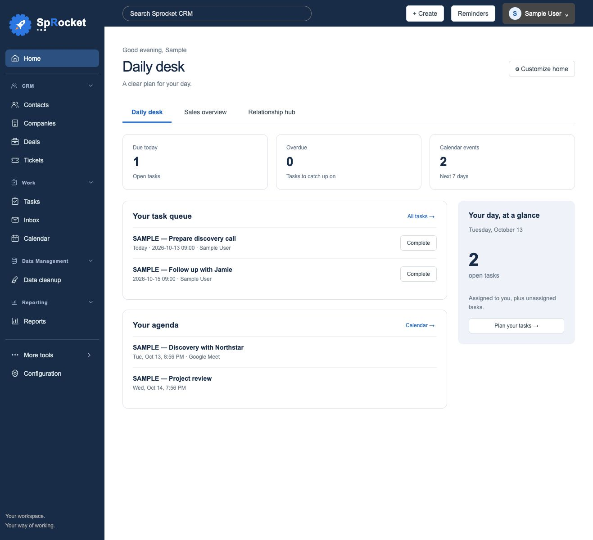
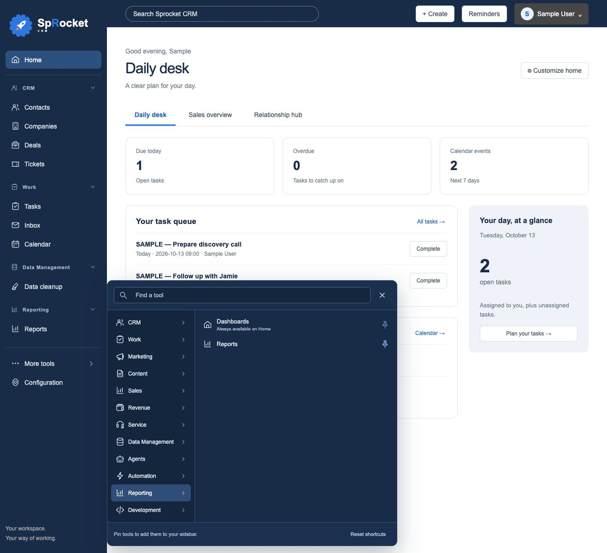

# Personal sidebar navigation

The More tools panel uses the sidebar’s navy palette with light text and blue pin indicators. The sidebar uses consistent local SVG icons and groups everyday work into:

- **CRM:** Contacts, Companies, Deals and Tickets.
- **Work:** Tasks, Inbox and Calendar.
- **Data Management:** Data cleanup.

**Home** and **Configuration** stay available. Home is the single dashboard entry, avoiding a second highlighted dashboard shortcut. Other sections appear when you pin a tool in that category. Existing custom record types appear under **Custom records** for users starting with the default shortcuts.

## Collapse a section

Select a section heading or its chevron to collapse or expand it. The heading reports its expanded state to assistive technology. Collapsed sections are remembered when you change pages, reload or sign in on another browser to the same installation.

## Pin or remove tools

1. Select **More tools**.
2. Choose a category, or use **Find a tool** to search across every category.
3. Select the pin beside a tool to add it to its matching sidebar section. Select the highlighted pin again to remove it.
4. To remove a shortcut directly, hover over it or focus it with the keyboard, then select **Remove from sidebar**. Narrow layouts show this control without hovering.

Removing a shortcut hides it from your sidebar; the tool remains in More. This does not delete records or disable a feature. **Reset shortcuts** restores the default shortcuts and expands all sections for your user. Home and Configuration, and aliases that already lead to Home, do not create duplicate sidebar entries.

Pinning a **Planned feature** does not implement it. Those entries remain clearly labeled in More and the sidebar. Data Model opens Properties, Data Enrichment opens its existing configuration screen, and Data cleanup opens the existing review tool.

The More panel stays open while browsing categories or changing pins. Close it with its close button, Escape, an outside click or by opening a tool. Keyboard users can move between category tabs with Up/Down/Home/End; Escape returns focus to More tools.

## Preference privacy and upgrades

Pins and collapsed sections are stored in the database for the authenticated user. Members can change their own navigation without administrator privileges; they cannot change another user's sidebar. The local app without sign-in uses a shared local operator profile. These navigation preferences do not change record permissions or workspace configuration.

When a custom record type is retired, its obsolete shortcut is omitted. The shared catalog in `web/navigation-catalog.json` supplies both server validation and the tools UI; individual users' settings are kept separately in the additive `navigation_preferences` table. Take a backup before installation upgrades as described in [UPDATES.md](UPDATES.md). Older browser-restorable SQLite backups must match the current database schema.

## Sample-data preview

