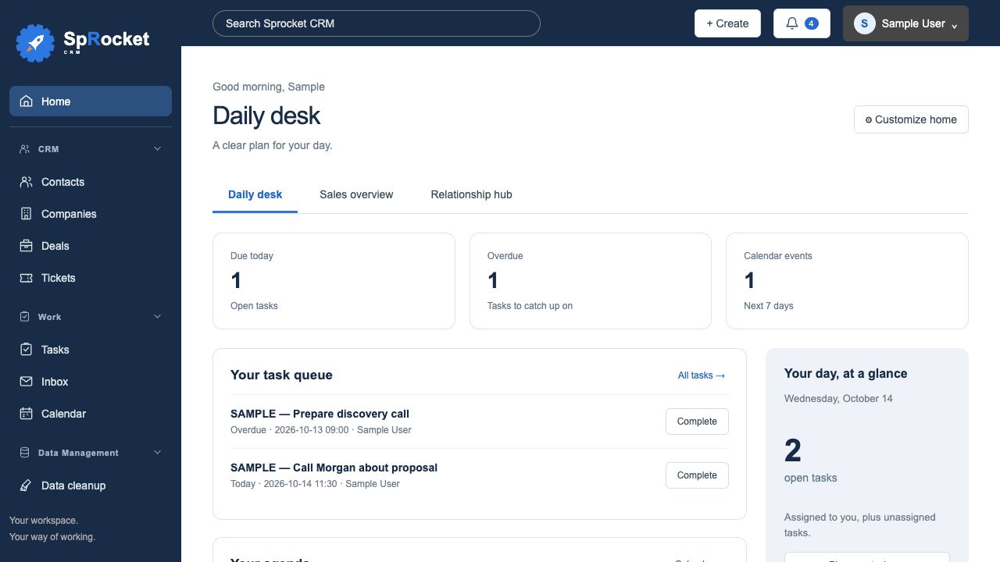
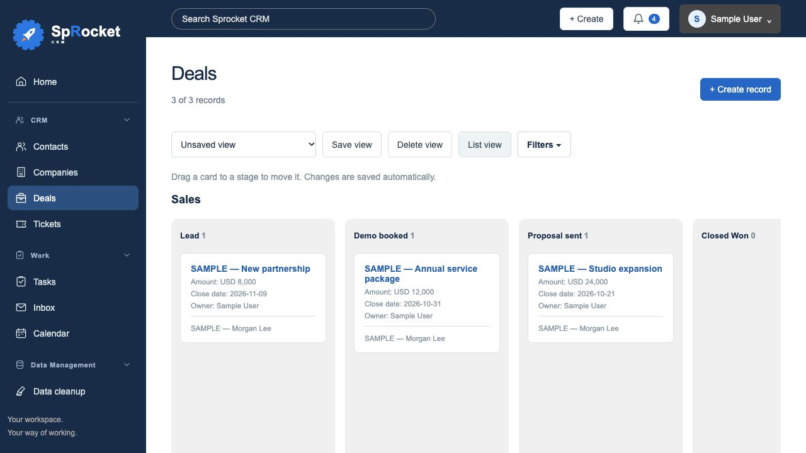
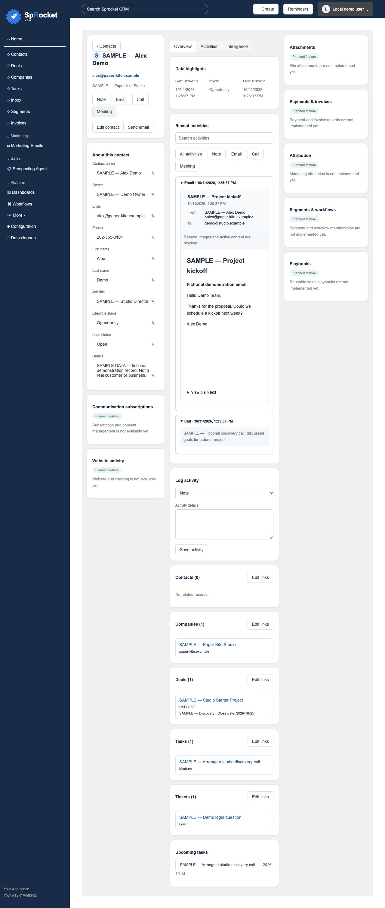
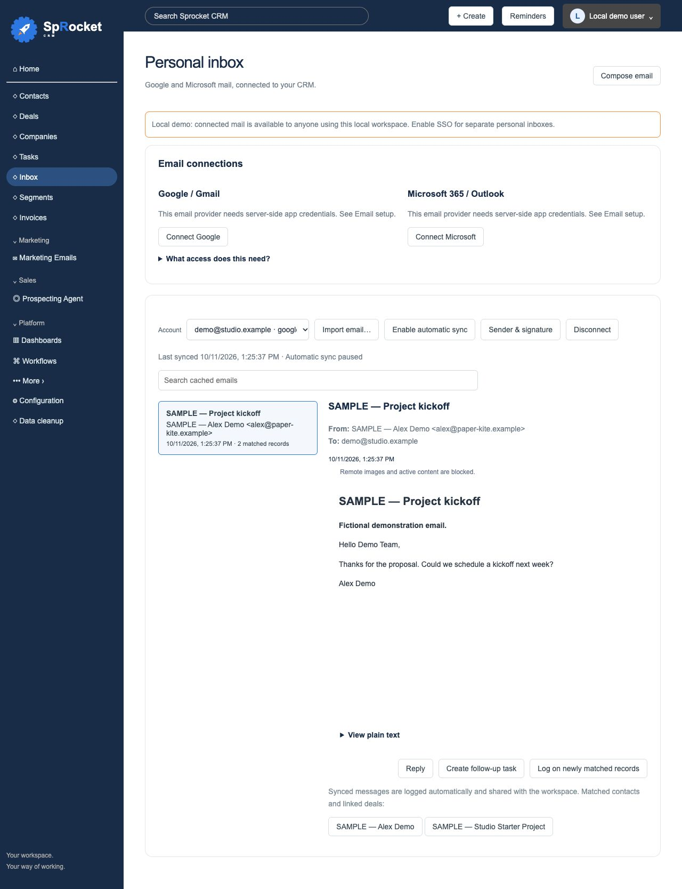

# SpRocket CRM

A free, MIT-licensed, configurable CRM foundation.

## Screenshots

These screenshots show the **v0.1.5 Mac preview**, using only clearly labeled fictional sample records and `.example` email addresses. Navigation also includes sections marked as planned within the app.

**Dashboard — record counts, pipeline value and recent activity.**



<details>
<summary>Deal board, contact record and personal inbox</summary>

### Deal board

Drag deals between stages and see total and weighted values.



### Contact record

Contact details, email activity and related companies, deals and tasks.



### Personal inbox

Cached sample email with CRM matching and follow-up controls. This demonstration inbox contains no real mailbox credentials or messages.



</details>

## Desktop app

**Mac download:** [v0.1.8 preview release](https://github.com/russrdfx/SpRocket-CRM/releases/tag/v0.1.8) for Apple Silicon Macs. The package passes strict signature integrity verification with an ad-hoc development signature; Developer ID signing and notarization remain planned. Avoid the defective v0.1.0 package.

An Apple Silicon Mac desktop installer now bundles the CRM and Python server, uses the full-color SpRocket icon, and keeps data outside the app. The preview build is ad-hoc signed for development and is not notarized. See [desktop installation, backups and build instructions](DESKTOP.md). Windows, Intel Mac and signed public releases remain planned.

## Run locally

Requires Python 3.9 or later. The local demo needs no packages. Optional SSO and email integrations require the dependencies in [SSO setup](SSO.md).

```sh
python3 server.py
```

Open http://127.0.0.1:8765. Set `PORT` to use another port and `SPROCKET_DB` to change the database location. Workspace data persists in `data/sprocket.db` and is excluded from Git.

## Working features

- Contacts, companies, deals, tasks and tickets, plus user-created record types.
- Create, edit, delete and search records.
- Typed custom fields: text, email, numbers, dates, checkboxes and selections.
- User-defined pipelines and stages for any record type. Stage names, order and probabilities are configurable.
- Board and list views, pipeline filtering, workspace owner names and currency.
- Drag cards between stages; changes persist automatically. Cards show owner, close date, amount and associations. Each stage shows total and probability-weighted value.
- Deal details page with properties, related records, searchable activity history and activity logging.
- Live reports for record counts, pipeline values and activity totals.
- Expanded two-column module navigation and searchable Settings categories with tabbed pages. Unimplemented sections are labeled **Planned feature**.
- Record relationships and notes, call, email and meeting activity logs.
- Personal Google and Microsoft inbox connections, date-range imports, optional automatic sync, rich-text compose/reply, HTML signatures, contact/deal matching and email follow-up tasks. See [Email setup](EMAIL.md); provider credentials and a stable token encryption key are required.
- Overview counts and weighted value using configured probabilities.
- Validation prevents removal of pipelines or stages still used by records.

The workspace starts empty. No external CRM records or configuration are imported. Activity logs do not send email or place calls. The separate Inbox compose/reply feature sends through a connected provider only when you choose Send.

## Optional sample data

```sh
python3 seed_sample.py
```

Adds 13 fictional records (3 contacts, 2 companies, 3 deals, 3 tasks and 2 tickets), four activity entries, a demo owner label and a three-stage demo pipeline. Every record name begins with `SAMPLE`; emails and websites use reserved `.example` domains. Run against the same `SPROCKET_DB` as the server, then reload the browser. Re-running skips existing sample records and activities. Existing records are preserved. The database itself is never committed.

## Recent interface updates

- Profile dropdown with profile details, account settings, SSO administration for designated admins, and sign-out for authenticated users. Local demo identity is labeled explicitly.
- Click dashboard tiles to open records or the weighted-value breakdown. Activity entries open their records; the Recent activity heading opens the full history.
- Contact details use a three-column layout with properties, activity search and filters, logging shortcuts, related records and upcoming linked tasks. Overview, Activities and Intelligence tabs show implemented functionality or an explicit planned status.
- Records without pipelines always use list view, preventing an empty board from hiding contacts, companies or tasks.
- Each sample deal has a linked contact, company and task. Sample relationships are visible from both ends in detail pages.

## Using the interface

- Open Deals and choose **Board view**. Drag a card into a stage, including a different pipeline, or into **No pipeline**.
- Click a contact to open its full details page. Use **Edit contact** or **Edit links** to edit properties and associations. Activity shortcuts log activity. The separate **Send email** button uses a connected account; calls are not placed.
- Click a deal to see its details. Use **Edit deal** for fields and relationships; use **Activities** to search, filter and log notes, emails, calls or meetings. These are logs, not delivery tools.
- Open **Configuration**: Account Defaults manages the workspace; Properties manages fields; Objects manages record types and pipelines.
- Use **More → Reporting → Reports** for the three live summaries. Other menu areas show their implementation status.

## Current scope

This is a local single-user development foundation, not a production deployment or functional CRM replacement. It binds to loopback only. Owner names are assignment labels, not login accounts. Team roles, audit history, collaboration, backups, an automation engine, closed-app inbox synchronization, bulk email delivery, marketing, quotes, invoicing and richer reporting remain roadmap work. Do not expose this development server publicly.

## Optional OpenID Connect SSO

Open **Configuration → Security → Single sign-on (SSO)** to save provider settings and test discovery. See [SSO setup](SSO.md) for provider registration, dependencies, environment configuration and activation.

Sign-in protects CRM pages and APIs when configured. Allowed identities share full workspace access; SSO administration requires server-designated administrator subjects. Secrets stay in the server environment. Saved non-secret settings stay in ignored local storage; environment values override them. Restart to activate changes.

The default unconfigured mode is a local demo without authentication. Discovery tests check provider metadata only; real-provider sign-in remains an integration check.

## Test

```sh
python3 test_server.py
# After installing SSO dependencies:
python3 -m unittest discover -p 'test_*.py'
```

Tests cover empty initialization, custom pipelines, persistent records, invalid stages, referenced-stage protection, activity cleanup, and cross-origin write rejection.

## License

MIT. See LICENSE.

## Brand assets

The supplied SpRocket vector logos, full-color symbol, monochrome variants, favicon and app icons are in `web/assets/brand/`. The app uses the dark horizontal logo in navigation, the light logo on sign-in, and the full-color favicon. The blue, orange and navy palette is applied to primary brand surfaces and accents. See [brand guide](web/assets/brand/guidelines/BRAND-GUIDE.md) for the supplied asset status and usage guidance. Selected PNG fallbacks are included alongside the vector library.

The canonical repository is [SpRocket-CRM](https://github.com/russrdfx/SpRocket-CRM). Its GitHub social preview uses the full-color logo with a 1280 × 640 canvas; editable vector and PNG versions are included in the logo directory.

## Personal email

Connect Google or Microsoft from **Inbox** or **Configuration → Integrations / Inboxes**. Setup instructions, supported scopes, privacy controls and limitations are in [EMAIL.md](EMAIL.md). Initial imports use a chosen date range; optional automatic checks run while the app is open. Sync automatically logs messages on contacts and linked deals, creates missing contacts, and links domain-based companies. The cache is owner-scoped under SSO; local demo mail is available to anyone using the local workspace. Provider registration and real-account integration checks remain necessary.

The email update passed 45 automated tests covering existing CRM/SSO behavior and mocked email-provider flows, including automatic record creation, activity deduplication, encrypted credentials, account ownership and send safeguards. Real-provider verification is still required.

## Create and edit records

The top **Create** dropdown opens Contact, Company, Deal, Ticket or Task in a right-side panel. Custom record types also appear. Record-list Create buttons use the same panels; edit keeps existing values and activity logging. Sticky actions include Create, Create and add another, Cancel, and Save for edits. Associations use searchable checkboxes instead of a multiple-selection list.

Contacts collect email, first/last name, owner, job title, phone, lifecycle stage and lead status. Companies collect domain/name, owner, industry/type, location, headcount, revenue, time zone, description and LinkedIn URL. Deals collect pipeline/stage, amount/date, owner/type/priority, relationships and description/quantity/price line items. A blank deal amount is calculated from its line items; an explicit amount is preserved. Tickets collect name, pipeline/status, description, source, owner, priority and create date. Tasks collect title, type, priority, relationships, assignee, queue, due date/time, reminder/repeat preferences and notes.

Tasks support completion, daily/weekly/monthly next occurrences, in-app reminders and optional desktop notifications while the app is open. Deal line items are saved data; a product catalog, quotes and invoicing remain planned. Pipelines are required when available, with a no-pipeline path for an unconfigured workspace. Contact names can be derived from first/last name or email; company names can be derived from domain.

New default properties are added once without overwriting custom definitions or existing records. Configure labels/options and add custom properties through **Configure properties**. Later user removal of a default property is respected after the migration.

Record creation update validation: 48 automated tests pass. Browser checks verified the dropdown, task/company/deal panels, contact name derivation, saved line items, calculated amount and Create and add another. Temporary verification records were removed.

### Email imports and contact editing

Choose a date range and preview its message count before importing email. Imports process the entire selected range in batches, show progress, and avoid duplicate activities. New contacts belong to the signed-in user (or connected email address in local mode). Contact properties support direct editing with Save and Cancel, and owner selectors include the current user and connected inbox addresses. See [EMAIL.md](EMAIL.md).

Email activities use a message layout with separate headers and body. Google HTML email is displayed in a restricted sandbox with remote content blocked. The Contacts Lead stage column uses Lifecycle stage; new imported contacts start at Lead.

Your top-right Profile & preferences menu supports editing your display name, job title and phone. Gmail messages inherit the connected address’s configured sender name, with an optional override under Inbox → Sender & signature. Profiles do not alter account roles or provider identities.

## Productivity tools

- **Inbox → Import email** keeps the initial date-range preview. Enable automatic sync after import, or enable/pause it from the inbox toolbar. Checks run roughly once a minute while the CRM window is open.
- **Data cleanup** lists exact email/domain duplicates, imported records and previously imported personal-domain companies. Review field differences and select the primary record before merging. Primary populated fields win; missing fields, relationships and activities are preserved. Merging removes the secondary record and cannot be undone.
- Common personal email domains such as Gmail and Outlook create individual contacts without new domain companies. Existing records are preserved for review.
- **Tasks** has open/completed filters and completion buttons. Repeating tasks advance on completion rather than generating duplicate task records. **Reminders** in the top bar supports snoozing and dismissing; desktop notifications require user permission.
- **Inbox → Sender & signature** supports rich text / HTML, links and uploaded images under 150 KB. Compose and reply use the same formatting editor. Plain-text signature mode remains available.

See [Productivity guide](PRODUCTIVITY.md) for behavior and testing.

Profile editing is available from the top-right **Profile & preferences** menu and **Configuration → General → Profile**. Display name, job title and phone are saved for the current sign-in identity (or the local workspace profile in demo mode). These changes are included in the v0.1.5 desktop preview linked above.

### Configure deal pipelines

Open **Settings → Pipelines → + Pipeline**, select **Deals**, enter a pipeline name, and add the stage names and probabilities. Save, then return to Deals to create a deal. **Configure pipelines & stages** is also available in Properties and the deal creation form. New workspaces begin without a pipeline so administrators can define their own process.

### Workspace productivity additions

Saved views and advanced record filters, reviewed CSV import/export, Google Calendar meeting logging, reviewed company website enrichment, opt-in follow-up task rules, and administrator backup/restore are implemented in the development source. See [WORKSPACE.md](WORKSPACE.md) for usage and limits, and [CALENDAR.md](CALENDAR.md) for Google setup. These additions require the next desktop package; installing an earlier release does not update automatically.

Phone fields on contacts, companies and profiles support country selection, automatic international formatting and extensions. Configure a default country in Account Defaults. See [workspace instructions](WORKSPACE.md#phone-numbers).

Record-list filters are grouped in a compact dropdown. CSV imports and exports are managed in Configuration → Import & Export, with a record-type selector and all-record or saved-view export scope.

## Private web preview

A PostgreSQL-backed private web deployment is available alongside the Mac edition. Host one workspace on your own domain using Docker Compose, with HTTPS, first-run administrator setup, invitations, persistent sessions and background email/task-rule checks. See [web deployment instructions](WEB.md) for setup, Google registration, migration, backups and current preview limits.

A [Render Free pilot template](RENDER.md) is included for short testing with fictional data. It uses manual sync and an expiring free database; self-hosted Docker Compose remains the persistent deployment option.
